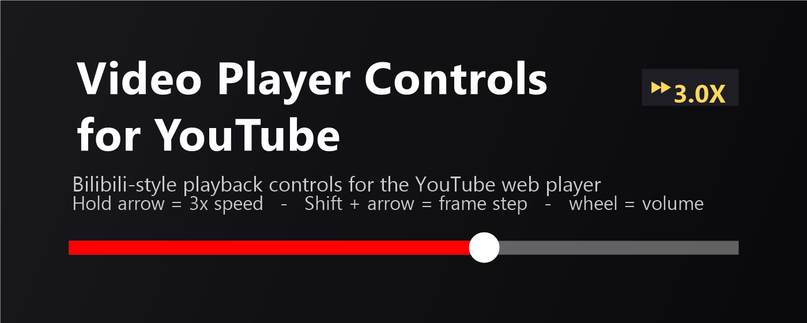
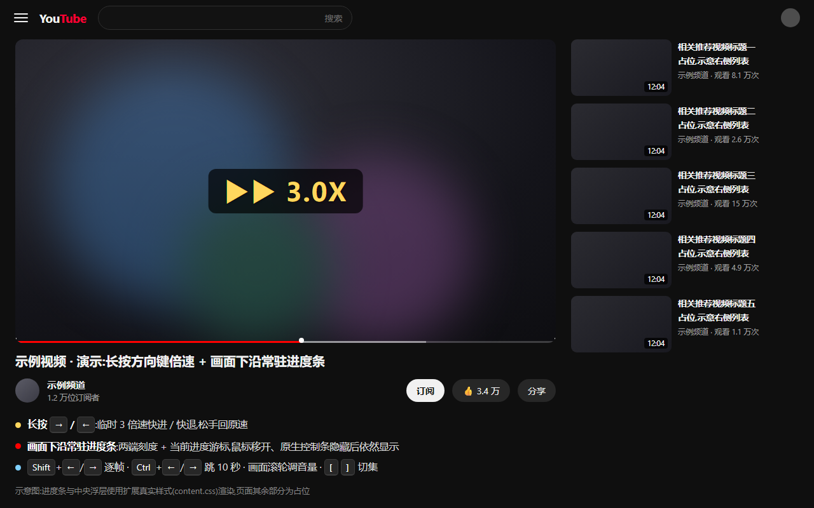
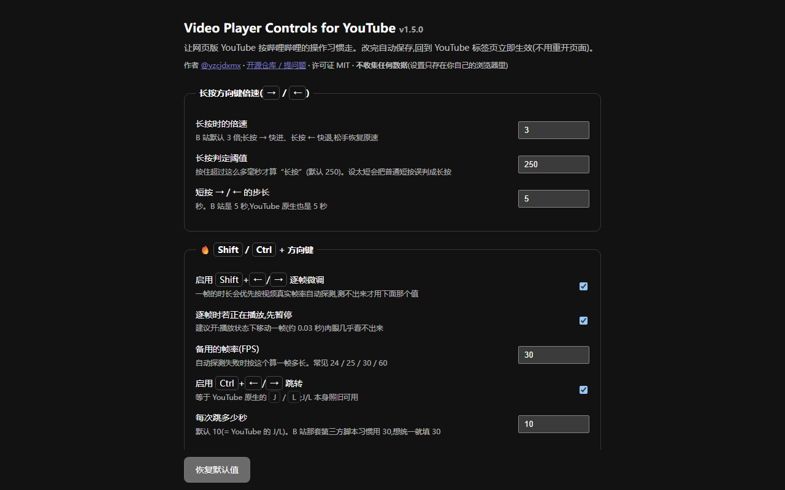
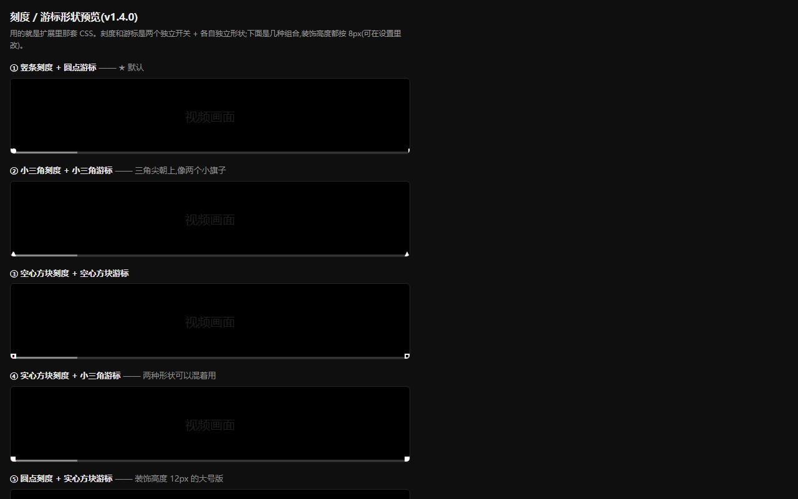
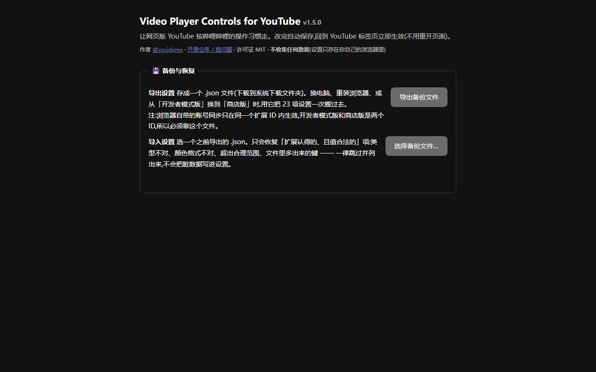

# 🎬 Video Player Controls for YouTube

**中文** ｜ [English](README.en.md)

> 让**网页版 YouTube** 的播放器,按**哔哩哔哩的操作习惯**走 —— 长按方向键临时倍速、`Shift` 逐帧、常驻进度条、可锁定默认清晰度。
> 纯 Chromium 扩展(Manifest V3),**不联网、不采集数据、只申请 `storage` 一个权限**。

[](LICENSE)
[](extension/manifest.json)
[](PRIVACY.md)
[](#-测试)



## 📸 截图

<p align="center">
  
  
</p>
<p align="center">
  
  
</p>

> 截图用扩展**真实样式**渲染(第一张的播放页背景为占位,图上已注明「示意图」);点图可看大图。

---

## ✨ 它做什么

| 操作 | 行为 |
|---|---|
| **长按 `→` / `←`** | 临时 **3 倍速**快进 / 快退,松手回原速(阈值 250 ms,倍速可改) |
| `→` / `←` | 快进 / 快退 **5 秒** |
| **`Shift` + `←` / `→`** | **逐帧**微调(自动探测真实帧率;播放中会先暂停) |
| **`Ctrl` + `←` / `→`** | 跳 **10 秒**(等于 YouTube 原生的 `J` / `L`,秒数可改) |
| **鼠标停在画面上滚滚轮** | 调**音量**(非全屏也生效,一格 2%) |
| `[` / `]` | 上一集 / 下一集 |
| **画面下沿常驻进度条** | 鼠标移开、原生控制条淡出后**它依然在**;两端有刻度、当前进度有游标;颜色 / 高度 / 开关 / 形状(竖条・圆点・小三角・实心方块・空心方块)全部可配 |
| **默认清晰度** | 保持自动 / **最高可用** / 指定 1080p、720p… 每个视频自动套用 |
| **💾 备份与恢复** | 把 23 项设置**导出成一个 .json**,在另一台机器/另一份扩展上**一键恢复** —— 换电脑、重装浏览器、从开发者模式版换到商店版,都不用重设 |
| 中央浮层 | B 站风格提示:`▶▶ 3.0X`(金色)、音量、跳转、帧步进 |

YouTube 原生的空格暂停、`↑↓` 音量、`M` 静音、`F` 全屏、`0–9` 跳百分比、单击暂停、双击全屏**全部照旧**,本扩展不重复接管。

## 📥 安装

**方式一 · 扩展商店(推荐,能自动更新)** ✅ **已上架**
Microsoft Edge 加载项商店:<https://microsoftedge.microsoft.com/addons/detail/lipeaalamcjacgahnjgjfafgekfegnmd>

**方式二 · 从源码加载(开发者模式)**
1. 下载本仓库(绿色 `Code` → `Download ZIP`,或 `git clone`)
2. 浏览器打开 `edge://extensions`(Chrome 是 `chrome://extensions`)
3. 打开 **开发者模式 / Developer mode** → 点 **加载解压缩的扩展 / Load unpacked**
4. 选中本仓库里的 **`extension`** 这一层目录(选外层会报 *Manifest file is missing or unreadable*)

> ⚠️ 商店版和开发者模式版是**两个不同的扩展 ID**,同一台浏览器里**只留一份**(否则按键会被处理两次、进度条画两条)。
> 换了版本想带走设置:在设置页**导出备份**,在新那份上**导入**即可。
> 改了代码之后:**先在扩展页点卡片上的 🔄 重新加载,再刷新 YouTube 页面**(顺序不能反)。

## ⚙️ 设置

点**浏览器工具栏上的扩展图标**,或扩展页 →「扩展程序选项」/ *Extension options*。**23 项设置**,改完即时生效、不用刷新页面:

- **长按倍速**:倍速值(默认 3.0×)、长按判定阈值(250 ms)、短按步长(5 s)
- **Shift / Ctrl**:逐帧开关、逐帧时是否先暂停、备用帧率(30)、跳转开关与秒数(10 s)
- **进度条**:启用、颜色(默认 YouTube 红 `#ff0000`)、条身高度(3 px)
- **刻度 / 游标**:两个**独立开关** + 各自形状 + 装饰高度(8 px)、悬停时是否让位
- **清晰度**:保持默认(自动)/ 最高可用 / 144p–2160p
- **总开关**:整个扩展、长按 `←` 也倍速、中央浮层、画面滚轮音量、`[` `]` 切集
- **💾 备份与恢复**:导出设置 / 导入设置(见下)

### 💾 备份与恢复怎么用

1. 旧的那份:设置页最下面 →「**导出备份文件**」→ 下载一个 `.json`
2. 新的那份:→「**选择备份文件…**」→ 选那个 `.json` → 23 项一次恢复

导入很保守:只恢复「扩展认得的、值也合法的」项 —— 类型不对、颜色格式不是 `#rrggbb`、数值超出合理范围、文件里多出来的键,一律**跳过并列出来**,不会把脏数据写进设置。这套校验是纯函数(`extension/backup.js`),有 **48 项**专门的测试盯着。

## 🔒 隐私

**不采集任何数据、不发出任何网络请求、只用 `storage` 一个权限**(且只用来保存你自己的设置)。
备份文件也**只落在你自己的硬盘上**,扩展不会上传它。详见 [PRIVACY.md](PRIVACY.md)。代码全部在此仓库,欢迎审阅。

## 🗂 仓库结构

```
extension/             ← 扩展本体(加载/打包的就是这一层)
├─ manifest.json       ← MV3:隔离世界注入 content/progress/quality + css;主世界注入 quality-main;名字与描述走 i18n
├─ _locales/           ← 多语言:en(默认) + zh_CN —— 商店靠它识别可用语言
├─ content.js          ← 按键 / 倍速(隔离世界)
├─ progress.js         ← 常驻进度条(隔离世界)
├─ quality.js          ← 默认清晰度:读设置 + postMessage(隔离世界)
├─ quality-main.js     ← 默认清晰度:调播放器接口(★ 主世界 world:"MAIN")
├─ backup.js           ← 设置备份/恢复的纯逻辑(不碰 chrome API 与 DOM,所以能自测)
├─ background.js       ← 点工具栏图标 → 打开设置页
├─ content.css         ← 浮层 + 进度条样式
├─ options.html / .js  ← 设置页(含备份与恢复)
└─ icons/              ← 16 / 32 / 48 / 128 / 300 图标
test/                  ← 无依赖的浏览器自测页(直接打开即跑)
```

## ✅ 测试

四套自测页,共 **217 项断言**,不需要 Node、不需要任何依赖 —— 打开 `test/` 里的 html 就会自动跑完并打印 `PASS` / `FAIL`:

| 测试页 | 项数 | 覆盖 |
|---|---|---|
| `test/smoke.html` | 72 | 按键/倍速/逐帧/跳转全部行为 + manifest 校验(权限、注入项、图标、商店要求)+ i18n 语言包校验(描述 ≤132 字符等) |
| `test/smoke-progress.html` | 70 | 进度条:两个开关独立、五种形状、高度、0%/100% 贴边、滚动同帧落位、全屏分支 |
| `test/smoke-quality.html` | 27 | 默认清晰度:跨世界链路、已在目标档位就跳过、档位不存在时退让、接口缺失安全收场 |
| `test/smoke-backup.html` | 48 | 备份/恢复:往返一致、坏 JSON、类型错、超范围夹紧、非法颜色、枚举白名单、原型污染防护、扁平格式兼容 |

`test/bench-cpu.html` 是可复现的性能基准:播放中约 **0.33% 单核**(保守上界),空闲时零开销。

## 🛠 打包

```powershell
# 把 extension/ 打成 ZIP(manifest.json 在根目录,可直接提交商店)
Compress-Archive -Path extension\* -DestinationPath video-player-controls-for-youtube.zip -Force
```

## ⚠️ 已知限制

- 只对 `www.youtube.com` / `m.youtube.com` **页面内**的播放器生效;别家网站嵌的 YouTube iframe 不生效;手机 App 不生效
- 进度条是页面级悬浮层,滚出视口会自动隐藏;全屏时挂进全屏元素
- 「默认清晰度」走播放器内部接口(YouTube 未提供公开 API),**YouTube 改版可能失效** —— 只影响这一个功能
- 选「最高可用」/4K 会放弃自适应,网速差时会卡

## 📄 许可证与声明

[MIT](LICENSE)。

本项目与 YouTube / Google / 哔哩哔哩(Bilibili) **均无任何关联**,也未被其赞助或认可;名称中的 “YouTube” 仅用于说明兼容性。你应遵守相应平台的服务条款。

## 💬 反馈

发现 bug 或有功能建议 → [开 Issue](https://github.com/yzcjdxmx/video-player-controls-for-youtube/issues)。
